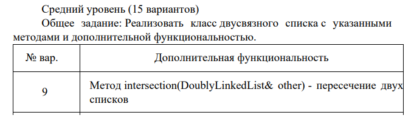
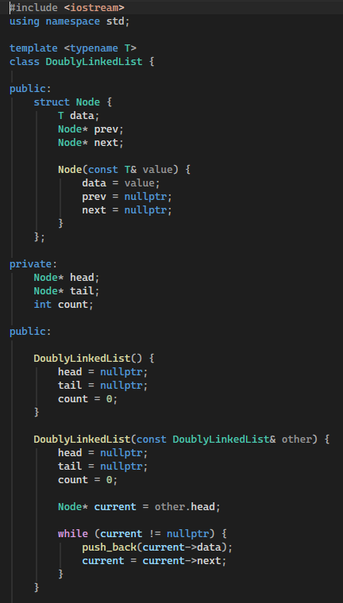
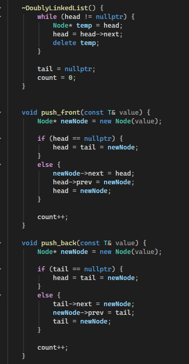
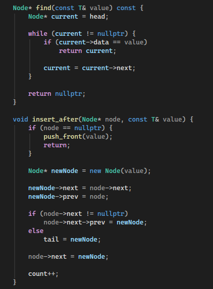
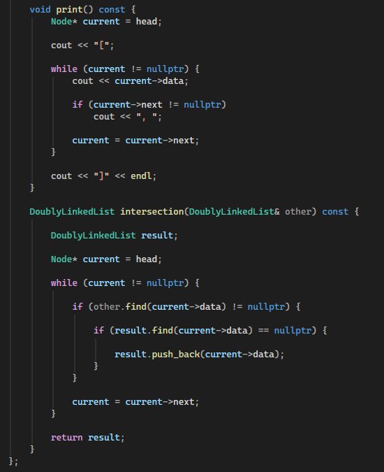
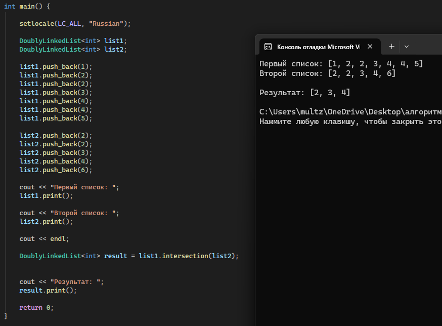

https://github.com/NXGHTMXRE007/alg4

# Лабораторная работа №4: Односвязный и двусвязный списки

**Студент:** Евдокимов Иван Александрович
**Группа:** ПИЖ-б-о-25-2(1)
**Вариант:** 9

## Цель работы:
1. Реализовать шаблонный класс односвязного списка (SinglyLinkedList) с базовыми операциями  
2. Реализовать шаблонный класс двусвязного списка (DoublyLinkedList) с базовыми операциями  
3. Освоить операции вставки, удаления, поиска и обхода элементов в списках  
4. Сравнить производительность и особенности использования односвязного и двусвязного списков  
5. Научиться правильно управлять памятью при работе со списками (удаление узлов)  

## Выполнение практического  задания

  

  

  

  

  

  

Контрольные вопросы  
1. Чем связный список отличается от динамического массива?  
Связный список хранит элементы в узлах, связанных указателями, а динамический массив — в непрерывной области памяти.  

2. Какие операции в односвязном списке выполняются за O(1)?  
Добавление и удаление элемента в начале списка, а также добавление в конец при наличии указателя tail.  

3. Почему удаление из конца односвязного списка требует O(n) времени?  
Потому что нужно пройти весь список, чтобы найти предпоследний элемент.  

4. Какие преимущества даёт хранение указателя tail в односвязном списке?  
Позволяет быстро получать последний элемент и добавлять элементы в конец за O(1).  

5. Чем двусвязный список отличается от односвязного?  
В двусвязном списке каждый узел хранит указатели на следующий и предыдущий элементы.  

6. Какие операции в двусвязном списке выполняются быстрее, чем в односвязном?  
Удаление и перемещение между элементами в обоих направлениях, если известен нужный узел.  

7. Что такое «голова» (head) и «хвост» (tail) списка?  
Head — указатель на первый элемент, tail — указатель на последний элемент списка.  

8. Как удалить узел из середины односвязного списка?  
Найти предыдущий узел и изменить его указатель на следующий после удаляемого.  

9. Как удалить узел из середины двусвязного списка? Почему это проще?  
Связать предыдущий узел со следующим, изменив два указателя. Это проще, потому что есть ссылка на предыдущий узел.  

10. Что произойдёт, если забыть обновить tail при удалении?  
Tail будет указывать на удалённую область памяти, что может привести к ошибкам и неопределённому поведению.  

11. Как реализовать реверс односвязного списка?  
Последовательно изменить указатели next каждого узла на предыдущий элемент, используя три указателя: prev, current и next.  

12. Как обнаружить цикл в связном списке?  
Использовать алгоритм Флойда: два указателя движутся с разной скоростью. Если они встретятся, цикл существует.  

13. В каких случаях стоит использовать список вместо массива?  
Когда часто добавляются и удаляются элементы, особенно в середине списка, и не нужен быстрый доступ по индексу.  

14. Какая дополнительная память требуется для каждого узла списка?  
Для указателей: один в односвязном списке и два в двусвязном, помимо памяти под данные.  

15. Почему доступ по индексу в списке имеет сложность O(n)?  
Потому что для получения элемента нужно последовательно пройти от начала списка до нужного индекса.   